[中文](00-overview.zh-CN.md) | [English](00-overview.md)

# C++ Mastery Roadmap

This roadmap turns the repository into a staged learning path.
It is not meant to be exhaustive.
It is meant to help you move between concepts, pitfalls, examples, and projects
without getting lost.

**[Learning Path Diagram](00-learning-path.md)** — visual dependency graph of all 43 stages.

## How To Use This Roadmap

- Each stage has four parts:
  core topics, pitfalls, examples, and something to build or improve.
- Do not try to read the whole repository linearly.
- Finish one small cycle at a time:
  learn one idea, inspect one failure mode, then change code.
- Some projects in this roadmap are intentionally incomplete.
  The point is to study and extend them, not just consume them.

## Learning Path

```mermaid
graph TD
    subgraph Foundations ["Stage 1-7: Foundations"]
        S1[Stage 1: Ownership & Lifetime]
        S2[Stage 2: Intermediate]
        S3[Stage 3: Advanced]
        S4[Stage 4: Practice]
        S5[Stage 5-7: More Practice]
    end

    subgraph Patterns ["Stage 8-27: Design Patterns"]
        S8[Stage 8-9: GoF Basics<br>Command / Observer / Strategy]
        S10[Stage 10-11: GoF Creational<br>Factory / Builder / Adapter]
        S12[Stage 12-13: GoF Structural<br>Flyweight / Visitor / Singleton]
        S14[Stage 14-15: GoF Advanced<br>Interpreter / Composite / Proxy]
        S16[Stage 16-19: Pattern Variants]
        S20[Stage 20-23: Pattern Combinations]
        S24[Stage 24-26: Advanced Patterns]
        S27[Stage 27: GoF Complete<br>Bridge / Facade / Specification]
    end

    subgraph Architecture ["Stage 28-31: Architecture"]
        S28[Stage 28-29: MVC / Repository / CQRS / Event Sourcing]
        S30[Stage 30-31: Service Locator / UoW / Active Record / Type Object]
    end

    subgraph Advanced ["Stage 32-38: Advanced Topics"]
        S32[Stage 32-33: Concurrency<br>Guarded Suspension / Producer-Consumer]
        S34[Stage 34: C++ Specific<br>CRTP / SFINAE / Variadic]
        S35[Stage 35: Memory<br>Pool / Arena / Slab]
        S36[Stage 36: Modern C++<br>Coroutines / Ranges / Concepts]
        S37[Stage 37: Error Handling<br>Result / Error Code / Expected]
        S38[Stage 38: Testing<br>Mock / Fixture / Parameterized]
    end

    subgraph Capstone ["Stage 39-43: Capstone & Extras"]
        S39[Stage 39: Content Enhancement]
        S40[Stage 40: C++23 Features]
        S41[Stage 41: Capstone<br>Mini HTTP Framework]
        S42[Stage 42: Performance<br>Cache / SIMD / Alignment]
        S43[Stage 43: Toolchain<br>CMake / CI/CD / Packages]
    end

    S1 --> S2 --> S3 --> S4 --> S5
    S5 --> S8
    S8 --> S10 --> S12 --> S14 --> S16 --> S20 --> S24 --> S27
    S27 --> S28 --> S30
    S30 --> S32 --> S34 --> S35 --> S36 --> S37 --> S38
    S38 --> S39 --> S40 --> S41 --> S42 --> S43

    style Foundations fill:#e8f5e9,stroke:#2e7d32
    style Patterns fill:#e3f2fd,stroke:#1565c0
    style Architecture fill:#fff3e0,stroke:#ef6c00
    style Advanced fill:#fce4ec,stroke:#c62828
    style Capstone fill:#f3e5f5,stroke:#6a1b9a
```

**Quick Path:** Stages 1→8→28→32→41 (minimal viable learning)
**Complete Path:** All 43 stages in order

## Stage 1: Foundations

Focus:
ownership, lifetime, RAII, `const`, and undefined behavior.

Read:

- [Ownership - Starting from Here](../docs/en/ownership-starts-here.md)
- [Ownership and Lifetime](../docs/en/ownership-and-lifetime.md)
- [RAII and Exception Safety](../docs/en/raii-and-exception-safety.md)
- [The True Semantics of `const`](../docs/en/the-true-semantics-of-const.md)
- [Undefined Behavior](../docs/en/undefined-behavior.md)
- [Rule of Zero, Rule of Three, and Rule of Five](../docs/en/rule-of-zero-three-five.md)
- [Lvalue References](../docs/en/lvalue-references.md)
- [Rvalue References](../docs/en/rvalue-references.md)
- [Glossary](../docs/en/glossary.md)

Pitfalls:

- [Dangling Pointer](../pitfalls/en/dangling-pointer.md)
- [Returning Reference to Local Object](../pitfalls/en/returning-reference-to-local-object.md)
- [Throwing from Destructor](../pitfalls/en/throwing-from-destructor.md)
- [Const Correctness Pitfalls](../pitfalls/en/const-correctness-pitfalls.md)
- [Narrowing Conversions in Initialization](../pitfalls/en/narrowing-conversions.md)
- [Signed Integer Overflow Assumptions](../pitfalls/en/signed-integer-overflow-assumptions.md)
- [Implicit Conversions](../pitfalls/en/implicit-conversions.md)
- [Double Free](../pitfalls/en/double-free.md)

Examples:

- [ownership-and-lifetime.cpp](../examples/ownership-and-lifetime.cpp)
- [const-vs-non-const.cpp](../examples/const-vs-non-const.cpp)

Practice:

- Read through the beginner exercise in
  [student-management/v1](01-beginner/student-management/v1)
- Improve one thing:
  input validation, file format design, separation of UI and domain logic, or
  error handling
- See [student-management/v2](01-beginner/student-management/v2) for an
  example of these improvements
- [student-management/v3](01-beginner/student-management/v3) takes it further
  with a borrowing ownership model built on `std::string_view` parameters

## Stage 2: References, Move, and Value Categories

Focus:
reference binding, move semantics, forwarding, copy elision, and interface design.

Read:

- [From Value Categories to Reference Binding](../docs/en/from-value-categories-to-reference-binding.md)
- [Lvalue References](../docs/en/lvalue-references.md)
- [Rvalue References](../docs/en/rvalue-references.md)
- [Lvalue and Rvalue References](../docs/en/lvalue-and-rvalue-references.md)
- [Understanding the Semantics of `std::move`](../docs/en/understanding-the-semantics-of-std::move.md)
- [Understanding Forwarding References and Perfect Forwarding](../docs/en/understanding-forwarding-references-and-perfect-forwarding.md)
- [Copy Elision and Prvalue Materialization](../docs/en/copy-elision-and-prvalue-materialization.md)
- [Noexcept and Move Operations](../docs/en/noexcept-and-move-operations.md)
- [Lvalue and Rvalue References: Binding Rules](../docs/en/reference-binding-rules.md)
- [`auto`, `decltype`, and `decltype(auto)`](../docs/en/auto-decltype-and-decltype-auto.md)
- [Template Instantiation and Two-Phase Lookup](../docs/en/template-instantiation-and-two-phase-lookup.md)

Pitfalls:

- [Moving from `const` Object](../pitfalls/en/moving-from-const-object.md)
- [Object Slicing](../pitfalls/en/object-slicing.md)
- [Implicit Conversions](../pitfalls/en/implicit-conversions.md)
- [Use After Move](../pitfalls/en/use-after-move.md)
- [Move Semantics Trap: Moving from a `const` Object](../pitfalls/en/const-object-move-trap.md)
- [SFINAE Misuse](../pitfalls/en/sfinae-misuse.md)
- [Fold Expression Errors](../pitfalls/en/fold-expression-errors.md)
- [Template Argument Deduction Pitfalls](../pitfalls/en/template-deduction-pitfalls.md)
- [Template Specialization Pitfalls](../pitfalls/en/template-specialization-pitfalls.md)

Examples:

- [move-semantics-example.cpp](../examples/move-semantics-example.cpp)
- [copy_on_write_example.cpp](../examples/copy_on_write_example.cpp)

Practice:

- Revisit the beginner project and make the ownership and interface boundaries
  more explicit
- Identify APIs that should borrow, own, or transfer ownership

## Stage 3: Object Model, Concurrency, and Deeper Semantics

Focus:
virtual dispatch, template instantiation, memory model, ABI boundaries, and
coroutine lifetime.

Read:

- [Virtual Dispatch and Object Model](../docs/en/virtual-dispatch-and-object-model.md)
- [Understanding the C++ Object Model](../docs/en/understanding-the-cpp-object-model.md)
- [C++ Memory Model and Atomics Basics](../docs/en/cpp-memory-model-and-atomics-basics.md)
- [Template Instantiation and Two-Phase Lookup](../docs/en/template-instantiation-and-two-phase-lookup.md)
- [PImpl and ABI Stability](../docs/en/pimpl-and-abi-stability.md)
- [Coroutines: Lifetime and Suspension Points](../docs/en/coroutines-lifetime-and-suspension-points.md)
- [C++20 Concepts In-Depth (C++20 Concepts)](../docs/en/cpp20-concepts.md)
- [Memory Pool & Allocators](../docs/en/memory-pool-and-allocators.md)
- [SIMD and Performance Optimization](../docs/en/simd-and-performance-optimization.md)
- [The Ranges Pattern In-Depth (Ranges Pattern)](../docs/en/ranges-pattern.md)
- [Testing Patterns in C++](../docs/en/testing-patterns.md)
- [std::expected — A Type-Safe Answer for Error Handling (C++23)](../docs/en/std-expected.md)
- [CMake & Build Systems](../docs/en/cmake-and-build-systems.md)

Pitfalls:

- [Broken Double-Checked Locking](../pitfalls/en/broken-double-checked-locking.md)
- [The Myth of Thread Safety](../pitfalls/en/the-myth-of-thread-safety.md)
- [Iterator Invalidation](../pitfalls/en/iterator-invalidation.md)
- [Static Initialization Order Fiasco](../pitfalls/en/static-initialization-order-fiasco.md)
- [Data Race](../pitfalls/en/data-race.md)
- [Deadlock](../pitfalls/en/deadlock.md)
- [Livelock](../pitfalls/en/livelock.md)
- [Priority Inversion](../pitfalls/en/priority-inversion.md)
- [Thread Leak](../pitfalls/en/thread-leak.md)
- [Dangling Lambda Captures](../pitfalls/en/dangling-lambda-captures.md)
- [Dangling `std::string_view`](../pitfalls/en/dangling-string-view.md)
- [Object Lifetime and Destruction Order Pitfalls](../pitfalls/en/object-lifetime-and-destruction-order-pitfalls.md)
- [Memory Order Pitfalls](../pitfalls/en/memory-order-pitfalls.md)
- [Concurrency Pitfall: The Thread-Safety Composition Fallacy](../pitfalls/en/thread-safety-composition-fallacy.md)
- [Memory Leaks](../pitfalls/en/memory-leak.md)
- [Memory Fragmentation](../pitfalls/en/memory-fragmentation.md)
- [Stack Overflow](../pitfalls/en/stack-overflow.md)
- [Uninitialized Member Variables](../pitfalls/en/uninitialized-members.md)
- [Macro Pitfalls](../pitfalls/en/macro-pitfalls.md)

Practice:

- Pick one pitfall and write a minimal reproduction case for it
- Then rewrite the code with a safer ownership or synchronization model
- Build one of the Stage 3 projects to practice concurrency and systems programming

### Stage 3 Projects

- [thread-pool](03-advanced/thread-pool/README.md):
  concurrent task execution with futures and synchronization
- [allocator](03-advanced/allocator/README.md):
  fixed-block memory allocator with STL interface
- [json-parser](03-advanced/json-parser/README.md):
  recursive descent parser with type-safe value tree
- [skip-list](03-advanced/skip-list/README.md):
  probabilistic ordered set with randomized levels
- [csv-parser](03-advanced/csv-parser/README.md):
  RFC-4180 quoting rules with roundtrip formatting
- [smart-pointer](03-advanced/smart-pointer/README.md):
  own implementation of unique_ptr, shared_ptr and weak_ptr
- [static-init-demo](03-advanced/static-init-demo/README.md):
  the static initialization order fiasco and the function-scope static fix
- [event-loop](03-advanced/event-loop/README.md):
  event loop for asynchronous programming
- [http-parser](03-advanced/http-parser/README.md):
  HTTP request and response parser
- [base64-codec](03-advanced/base64-codec/README.md):
  RFC 4648 encode/decode with strict padding validation

## Stage 4: Build Larger Things

Focus:
turning semantics into design decisions in real code.

Start with:

- [02 Intermediate Overview](02-intermediate/README.md)

Projects:

- [tiny-http-server](02-intermediate/tiny-http-server/README.md):
  socket handling, request parsing, routing, response construction, fixed-size worker pool
- [key-value-store](02-intermediate/key-value-store/README.md):
  design-stage storage exercise focused on state ownership and persistence boundaries
- [tinyshell](../tinyshell/README.md):
  side project for command parsing and process/system behavior
- [trie](02-intermediate/trie/README.md):
  prefix tree with word/prefix counts and lexicographic enumeration
- [union-find](02-intermediate/union-find/README.md):
  DSU with iterative path compression and union by rank
- [copy-move-demo](02-intermediate/copy-move-demo/README.md):
  prints every copy and move operation, so the chosen constructor is visible
- [reference-binding-demo](02-intermediate/reference-binding-demo/README.md):
  reference binding rules, the basis for move semantics and forwarding
- [binary-heap](02-intermediate/binary-heap/README.md):
  array-backed heap with comparator ordering and bottom-up heapify

Read:

- [Chat Server API](../docs/en/chat-server-api.md)
- [Simple Database API](../docs/en/simple-db-api.md)
- [Task Scheduler API](../docs/en/task-scheduler-api.md)
- [Connection Pool API](../docs/en/connection-pool-api.md)

Pitfalls:

- [Deleting Through a Non-Virtual Base Pointer](../pitfalls/en/deleting-through-non-virtual-base.md)
- [Iterator Invalidation](../pitfalls/en/iterator-invalidation.md)
- [Iterator Invalidation Pitfalls](../pitfalls/en/iterator-invalidation-pitfalls.md)
- [Object Slicing](../pitfalls/en/object-slicing.md)

### Stage 4 Projects (04-stage4)

- [simple-db](04-stage4/simple-db/README.md):
  in-memory database with table management and file persistence
- [chat-server](04-stage4/chat-server/README.md):
  multi-user chat server with rooms and commands
- [web-server](04-stage4/web-server/README.md):
  HTTP server with routing and middleware support
- [mini-redis](04-stage4/mini-redis/README.md):
  in-memory KV store with RESP-style replies and lazy TTL expiry

### C++20 Examples

- [cpp20-concepts.cpp](../examples/cpp20-concepts.cpp):
  concepts, requires expressions, constraints
- [cpp20-ranges.cpp](../examples/cpp20-ranges.cpp):
  ranges library, views, adaptors
- [cpp20-span.cpp](../examples/cpp20-span.cpp):
  non-owning views, subspan
- [cpp20-format.cpp](../examples/cpp20-format.cpp):
  std::format string formatting
- [cpp20-coroutines.cpp](../examples/cpp20-coroutines.cpp):
  generators, tasks, async patterns
- [cpp20-consteval.cpp](../examples/cpp20-consteval.cpp):
  consteval, constinit, compile-time evaluation

Suggested progression:

1. Read the stage overview and pick one project with explicit non-goals.
2. Build and inspect the current project state.
3. List the ownership boundaries, lifetime assumptions, and error paths.
4. Add one missing piece:
   tests, better parsing, RAII wrappers, clearer APIs, persistence rules, or
   documentation that matches the implementation.

## Current Status

This roadmap is a living guide, not a finished curriculum.
Some sections are dense, some projects are early-stage, and the repository still
has gaps between design intent and implementation.

That is normal for this project.
The goal is to make those gaps visible and then close them deliberately.

### Stage 5 Projects (05-stage5)

- [task-scheduler](05-stage5/task-scheduler/README.md):
  priority-based task scheduling with delayed and repeating tasks
- [web-framework](05-stage5/web-framework/README.md):
  simple HTTP web framework with routing and middleware
- [timer-wheel](05-stage5/timer-wheel/README.md):
  O(1) tick-based scheduling with absolute fire times

### Stage 6 Projects (06-stage6)

- [connection-pool](06-stage6/connection-pool/README.md):
  generic connection pool for managing reusable resources
- [ring-buffer](06-stage6/ring-buffer/README.md):
  thread-safe circular buffer for producer-consumer patterns
- [blocking-queue](06-stage6/blocking-queue/README.md):
  bounded MPMC queue with dual condition variables and close semantics
- [producer-consumer-demo](06-stage6/producer-consumer-demo/README.md):
  the producer-consumer pattern on top of the ring-buffer project

### Stage 7 Projects (07-stage7)

- [thread-safe-cache](07-stage7/thread-safe-cache/README.md):
  generic thread-safe cache with TTL support
- [lru-cache](07-stage7/lru-cache/README.md):
  LRU cache with O(1) operations and eviction
- [lfu-cache](07-stage7/lfu-cache/README.md):
  least-frequently-used eviction with LRU tie-breaking
- [bloom-filter](07-stage7/bloom-filter/README.md):
  probabilistic membership with double hashing over packed bits

Read:

- [Command Pattern](../docs/en/command-pattern.md)
- [Observer Pattern](../docs/en/observer-pattern.md)
- [Strategy Pattern](../docs/en/strategy-pattern.md)

### Stage 8 Projects (08-stage8)

- [object-pool](08-stage8/object-pool/README.md):
  generic object pool for reusing expensive objects
- [publish-subscribe](08-stage8/publish-subscribe/README.md):
  topic-based publish-subscribe messaging system
- [state-machine](08-stage8/state-machine/README.md):
  generic state machine for modeling state transitions
- [rate-limiter](08-stage8/rate-limiter/README.md):
  token bucket, fixed window and sliding window algorithms

Read:

- [Command Pattern](../docs/en/command-pattern.md)
- [Observer Pattern](../docs/en/observer-pattern.md)
- [Strategy Pattern](../docs/en/strategy-pattern.md)

### Stage 9 Projects (09-stage9)

- [command-pattern](09-stage9/command-pattern/README.md):
  command pattern with undo/redo support
- [observer-pattern](09-stage9/observer-pattern/README.md):
  observer pattern for event notification
- [strategy-pattern](09-stage9/strategy-pattern/README.md):
  strategy pattern for algorithm selection

Read:

- [Adapter Pattern](../docs/en/adapter-pattern.md)
- [Decorator Pattern](../docs/en/decorator-pattern.md)
- [Factory Method Pattern](../docs/en/factory-method-pattern.md)

### Stage 10 Projects (10-stage10)

- [decorator-pattern](10-stage10/decorator-pattern/README.md):
  decorator pattern for dynamic behavior composition
- [factory-pattern](10-stage10/factory-pattern/README.md):
  factory pattern for object creation
- [adapter-pattern](10-stage10/adapter-pattern/README.md):
  adapter pattern for interface compatibility

Read:

- [Builder Pattern](../docs/en/builder-pattern.md)
- [Mediator Pattern](../docs/en/mediator-pattern.md)
- [Prototype Pattern](../docs/en/prototype-pattern.md)

### Stage 11 Projects (11-stage11)

- [builder-pattern](11-stage11/builder-pattern/README.md):
  builder pattern for complex object construction
- [prototype-pattern](11-stage11/prototype-pattern/README.md):
  prototype pattern for object cloning
- [mediator-pattern](11-stage11/mediator-pattern/README.md):
  mediator pattern for object communication

Read:

- [Chain of Responsibility Pattern](../docs/en/chain-of-responsibility-pattern.md)
- [Flyweight Pattern](../docs/en/flyweight-pattern.md)
- [Visitor Pattern](../docs/en/visitor-pattern.md)

### Stage 12 Projects (12-stage12)

- [flyweight-pattern](12-stage12/flyweight-pattern/README.md):
  flyweight pattern for sharing common data
- [chain-of-responsibility](12-stage12/chain-of-responsibility/README.md):
  chain of responsibility for request handling
- [visitor-pattern](12-stage12/visitor-pattern/README.md):
  visitor pattern for operations on object structures

Read:

- [Memento Pattern](../docs/en/memento-pattern.md)
- [Singleton Pattern](../docs/en/singleton-pattern.md)
- [State Pattern](../docs/en/state-pattern.md)

### Stage 13 Projects (13-stage13)

- [singleton-pattern](13-stage13/singleton-pattern/README.md):
  singleton pattern for single instance management
- [null-object-pattern](13-stage13/null-object-pattern/README.md):
  null object pattern for handling null cases
- [memento-pattern](13-stage13/memento-pattern/README.md):
  memento pattern for state snapshots

Read:

- [Composite Pattern](../docs/en/composite-pattern.md)
- [Proxy Pattern](../docs/en/proxy-pattern.md)

### Stage 14 Projects (14-stage14)

- [interpreter-pattern](14-stage14/interpreter-pattern/README.md):
  interpreter pattern for language parsing
- [composite-pattern](14-stage14/composite-pattern/README.md):
  composite pattern for tree structures
- [proxy-pattern](14-stage14/proxy-pattern/README.md):
  proxy pattern for controlled access

Read:

- [Abstract Factory Pattern](../docs/en/abstract-factory-pattern.md)
- [Iterator Pattern](../docs/en/iterator-pattern.md)
- [Template Method Pattern](../docs/en/template-method-pattern.md)

### Stage 15 Projects (15-stage15)

- [abstract-factory](15-stage15/abstract-factory/README.md):
  abstract factory for creating families of objects
- [template-method](15-stage15/template-method/README.md):
  template method for algorithm skeleton
- [iterator-pattern](15-stage15/iterator-pattern/README.md):
  iterator pattern for traversing collections

Read:

- [Iterator Pattern](../docs/en/iterator-pattern.md)
- [Template Method Pattern](../docs/en/template-method-pattern.md)

### Stage 16 Projects (16-stage16)

- [double-dispatch](16-stage16/double-dispatch/README.md):
  double dispatch for multi-method polymorphism
- [virtual-constructor](16-stage16/virtual-constructor/README.md):
  virtual constructor for cloning without knowing type
- [object-pool-advanced](16-stage16/object-pool-advanced/README.md):
  advanced object pool with validation

Read:

- [Command Pattern](../docs/en/command-pattern.md)
- [Observer Pattern](../docs/en/observer-pattern.md)
- [Strategy Pattern](../docs/en/strategy-pattern.md)

### Stage 17 Projects (17-stage17)

- [command-batch](17-stage17/command-batch/README.md):
  command batch for grouping multiple commands
- [observer-event](17-stage17/observer-event/README.md):
  observer event system for event-driven architecture
- [strategy-cache](17-stage17/strategy-cache/README.md):
  strategy cache with LRU and TTL strategies

Read:

- [Command Pattern](../docs/en/command-pattern.md)
- [Observer Pattern](../docs/en/observer-pattern.md)
- [Strategy Pattern](../docs/en/strategy-pattern.md)

### Stage 18 Projects (18-stage18)

- [command-queue](18-stage18/command-queue/README.md):
  thread-safe command queue for async task execution
- [observer-pipeline](18-stage18/observer-pipeline/README.md):
  pipeline for chained data processing
- [strategy-selector](18-stage18/strategy-selector/README.md):
  dynamic strategy selection system

Read:

- [Command Pattern](../docs/en/command-pattern.md)
- [Observer Pattern](../docs/en/observer-pattern.md)
- [Strategy Pattern](../docs/en/strategy-pattern.md)

### Stage 19 Projects (19-stage19)

- [command-history](19-stage19/command-history/README.md):
  command history manager for logging and replay
- [observer-filter](19-stage19/observer-filter/README.md):
  observer pattern with event filtering
- [strategy-evaluator](19-stage19/strategy-evaluator/README.md):
  strategy evaluation system for performance comparison

Read:

- [Command Pattern](../docs/en/command-pattern.md)
- [Observer Pattern](../docs/en/observer-pattern.md)
- [Strategy Pattern](../docs/en/strategy-pattern.md)

### Stage 20 Projects (20-stage20)

- [command-validator](20-stage20/command-validator/README.md):
  command validation system
- [observer-mediator](20-stage20/observer-mediator/README.md):
  observer pattern combined with mediator
- [strategy-adapter](20-stage20/strategy-adapter/README.md):
  strategy adapter for interface compatibility

Read:

- [Command Pattern](../docs/en/command-pattern.md)
- [Observer Pattern](../docs/en/observer-pattern.md)
- [Strategy Pattern](../docs/en/strategy-pattern.md)

### Stage 21 Projects (21-stage21)

- [command-router](21-stage21/command-router/README.md):
  command routing system for dispatching commands
- [observer-bus](21-stage21/observer-bus/README.md):
  event bus for publish-subscribe communication
- [strategy-factory](21-stage21/strategy-factory/README.md):
  factory for creating strategies dynamically

Read:

- [Command Pattern](../docs/en/command-pattern.md)
- [Observer Pattern](../docs/en/observer-pattern.md)
- [Strategy Pattern](../docs/en/strategy-pattern.md)

### Stage 22 Projects (22-stage22)

- [command-logger](22-stage22/command-logger/README.md):
  command logging system for tracking operations
- [observer-throttler](22-stage22/observer-throttler/README.md):
  observer with throttled event dispatch
- [strategy-chain](22-stage22/strategy-chain/README.md):
  chain for executing multiple strategies

Read:

- [Command Pattern](../docs/en/command-pattern.md)
- [Observer Pattern](../docs/en/observer-pattern.md)
- [Strategy Pattern](../docs/en/strategy-pattern.md)

### Stage 23 Projects (23-stage23)

- [command-queue-v2](23-stage23/command-queue-v2/README.md):
  enhanced command queue with priority support
- [observer-buffer](23-stage23/observer-buffer/README.md):
  observer with buffered event dispatch
- [strategy-decorator](23-stage23/strategy-decorator/README.md):
  decorator pattern for adding behavior to strategies

Read:

- [Command Pattern](../docs/en/command-pattern.md)
- [Observer Pattern](../docs/en/observer-pattern.md)
- [Strategy Pattern](../docs/en/strategy-pattern.md)

### Stage 24 Projects (24-stage24)

- [command-snapshot](24-stage24/command-snapshot/README.md):
  command pattern with state snapshots for undo/redo
- [observer-subscription](24-stage24/observer-subscription/README.md):
  observer with RAII subscription management
- [strategy-pipeline](24-stage24/strategy-pipeline/README.md):
  data processing pipeline using strategy pattern

Read:

- [Command Pattern](../docs/en/command-pattern.md)
- [Observer Pattern](../docs/en/observer-pattern.md)
- [Strategy Pattern](../docs/en/strategy-pattern.md)

### Stage 25 Projects (25-stage25)

- [command-memento](25-stage25/command-memento/README.md):
  command pattern with memento for state preservation
- [observer-debouncer](25-stage25/observer-debouncer/README.md):
  observer with debounced event dispatch
- [strategy-combinator](25-stage25/strategy-combinator/README.md):
  strategy combinator for combining predicates

Read:

- [Command Pattern](../docs/en/command-pattern.md)
- [Observer Pattern](../docs/en/observer-pattern.md)
- [Strategy Pattern](../docs/en/strategy-pattern.md)

### Stage 26 Projects (26-stage26)

- [command-translator](26-stage26/command-translator/README.md):
  translates commands between different formats
- [observer-filter-chain](26-stage26/observer-filter-chain/README.md):
  observer with chained event filters
- [strategy-resolver](26-stage26/strategy-resolver/README.md):
  resolves strategies dynamically based on context

Read:

- [Bridge Pattern](../docs/en/bridge-pattern.md)
- [Facade Pattern](../docs/en/facade-pattern.md)
- [Specification Pattern](../docs/en/specification-pattern.md)

### Stage 27 Projects (27-stage27) — GoF 23 Complete

- [bridge-pattern](27-stage27/bridge-pattern/README.md):
  separates abstraction from implementation
- [facade-pattern](27-stage27/facade-pattern/README.md):
  simplified interface to complex subsystem
- [specification-pattern](27-stage27/specification-pattern/README.md):
  composable business rules

Read:

- [CQRS Pattern](../docs/en/cqrs-pattern.md)
- [MVC Pattern](../docs/en/mvc-pattern.md)
- [Repository Pattern](../docs/en/repository-pattern.md)

### Stage 28 Projects (28-stage28) — Architecture Patterns

- [mvc-pattern](28-stage28/mvc-pattern/README.md):
  Model-View-Controller architecture
- [repository-pattern](28-stage28/repository-pattern/README.md):
  data access abstraction
- [cqrs-pattern](28-stage28/cqrs-pattern/README.md):
  Command Query Responsibility Segregation

Read:

- [Event Sourcing Pattern](../docs/en/event-sourcing-pattern.md)

### Stage 29 Projects (29-stage29) — Architecture Patterns

- [event-sourcing](29-stage29/event-sourcing/README.md):
  event-based state management and replay
- [circuit-breaker](29-stage29/circuit-breaker/README.md):
  fault tolerance pattern preventing cascading failures
- [middleware-pipeline](29-stage29/middleware-pipeline/README.md):
  chained request/response processing

Read:

- [Active Record Pattern](../docs/en/active-record-pattern.md)
- [Service Locator Pattern](../docs/en/service-locator-pattern.md)
- [Unit of Work Pattern](../docs/en/unit-of-work-pattern.md)

### Stage 30 Projects (30-stage30) — Architecture Patterns

- [service-locator](30-stage30/service-locator/README.md):
  centralized service registry for dependency resolution
- [unit-of-work](30-stage30/unit-of-work/README.md):
  tracks changes and commits as a single transaction
- [active-record](30-stage30/active-record/README.md):
  object-relational mapping with persistence logic

Read:

- [Balking Pattern](../docs/en/balking-pattern.md)
- [Delegation Pattern](../docs/en/delegation-pattern.md)
- [Type Object Pattern](../docs/en/type-object-pattern.md)

### Stage 31 Projects (31-stage31) — Architecture Patterns

- [type-object](31-stage31/type-object/README.md):
  defines types as data objects for runtime creation
- [delegation](31-stage31/delegation/README.md):
  objects delegate behavior to collaborators
- [balking](31-stage31/balking/README.md):
  skips action when preconditions are not met

### Stage 32 Projects (32-stage32) — Concurrency Patterns

- [guarded-suspension](32-stage32/guarded-suspension/README.md):
  waits for condition before proceeding
- [producer-consumer](32-stage32/producer-consumer/README.md):
  bounded buffer with thread-safe push/pop
- [double-buffer](32-stage32/double-buffer/README.md):
  smooth data transition using two buffers

### Stage 33 Projects (33-stage33) — Concurrency Patterns

- [read-write-lock](33-stage33/read-write-lock/README.md):
  concurrent map with shared/exclusive locking
- [lock-free-queue](33-stage33/lock-free-queue/README.md):
  wait-free queue using atomic operations
- [thread-pool-advanced](33-stage33/thread-pool-advanced/README.md):
  task-based thread pool with futures
- [actor-mailbox](33-stage33/actor-mailbox/README.md):
  bounded mailbox with single-consumer actor loop

### Stage 34 Projects (34-stage34) — C++ Specific Patterns

- [crtp-pattern](34-stage34/crtp-pattern/README.md):
  Curiously Recurring Template Pattern
- [sfinae-pattern](34-stage34/sfinae-pattern/README.md):
  Substitution Failure Is Not An Anomaly
- [varargs-pattern](34-stage34/varargs-pattern/README.md):
  variadic templates for type-safe variadic functions
- [type-erasure](34-stage34/type-erasure/README.md):
  hand-rolled std::function-style wrapper with Concept/Holder split

### Stage 35 Projects (35-stage35) — Memory Patterns

- [memory-pool](35-stage35/memory-pool/README.md):
  pre-allocated fixed-size block pool
- [arena-allocator](35-stage35/arena-allocator/README.md):
  bump allocator for fast sequential allocation
- [slab-allocator](35-stage35/slab-allocator/README.md):
  size-classified memory cache
- [allocation-tracker](35-stage35/allocation-tracker/README.md):
  process-wide alloc counters and a counting STL allocator

Read:

- [C++20 Concepts In-Depth (C++20 Concepts)](../docs/en/cpp20-concepts.md)
- [Coroutines: Lifetime and Suspension Points](../docs/en/coroutines-lifetime-and-suspension-points.md)
- [The Ranges Pattern In-Depth (Ranges Pattern)](../docs/en/ranges-pattern.md)

### Stage 36 Projects (36-stage36) — Modern C++ Patterns

- [coroutine-pattern](36-stage36/coroutine-pattern/README.md):
  C++20 coroutines for lazy evaluation and generators
- [ranges-pattern](36-stage36/ranges-pattern/README.md):
  lazy-evaluated range pipelines
- [concepts-pattern](36-stage36/concepts-pattern/README.md):
  C++20 Concepts for compile-time constraints

### Stage 37 Projects (37-stage37) — Error Handling Patterns

- [result-type](37-stage37/result-type/README.md):
  type-safe error handling without exceptions
- [error-code](37-stage37/error-code/README.md):
  enum-based error reporting with messages
- [expected-pattern](37-stage37/expected-pattern/README.md):
  value-or-error with monadic operations
- [error-category](37-stage37/error-category/README.md):
  custom std::error_code category mapped to standard conditions

### Stage 38 Projects (38-stage38) — Testing Patterns

- [mock-objects](38-stage38/mock-objects/README.md):
  test doubles for verifying interactions
- [test-fixture](38-stage38/test-fixture/README.md):
  reusable test setup and teardown
- [parameterized-tests](38-stage38/parameterized-tests/README.md):
  data-driven test execution
- [golden-file-testing](38-stage38/golden-file-testing/README.md):
  snapshot assertions with line diffs and UPDATE_GOLDEN flow

### Stage 39 Projects (39-stage39) — Content Enhancement

- [markdown-parser](39-stage39/markdown-parser/README.md):
  block-level markdown to structured blocks with inline link extraction
- [link-checker](39-stage39/link-checker/README.md):
  relative link validation with lexical path normalization
- [text-diff](39-stage39/text-diff/README.md):
  LCS line diff with unified-style rendering and similarity score
- [bilingual-doc-checker](39-stage39/bilingual-doc-checker/README.md):
  language detection and heading/code parity between the English and Chinese halves

### Stage 40 Projects (40-stage40) — C++23 Features

- [std-print](40-stage40/std-print/README.md):
  type-safe formatted output with variadic templates
- [deducing-this](40-stage40/deducing-this/README.md):
  C++23 explicit object parameter for fluent APIs
- [zip-range](40-stage40/zip-range/README.md):
  parallel iteration over multiple containers
- [generator-pipeline](40-stage40/generator-pipeline/README.md):
  lazy std::generator pipelines with early-exit propagation

### Stage 41 — Capstone Project

- [mini-http-framework](41-stage41/mini-http-framework/README.md):
  Complete HTTP framework combining 10 design patterns:
  Middleware Pipeline, Strategy, Observer, Command, Factory,
  Builder, Type Erasure, Facade, Singleton, Decorator
- [http-router](41-stage41/http-router/README.md):
  method+path routing with :param extraction
- [template-engine](41-stage41/template-engine/README.md):
  mustache-like sections with context chaining

### Stage 42 Projects (42-stage42) — Performance Patterns

- [cache-friendly](42-stage42/cache-friendly/README.md):
  AoS vs SoA data layout for cache performance
- [simd-pattern](42-stage42/simd-pattern/README.md):
  manual SIMD-style vectorization for math operations
- [memory-alignment](42-stage42/memory-alignment/README.md):
  cache-line alignment and aligned allocation

### Stage 43 Projects (43-stage43) — Toolchain Patterns

- [cmake-pattern](43-stage43/cmake-pattern/README.md):
  programmatic CMakeLists.txt generation
- [package-manager](43-stage43/package-manager/README.md):
  dependency resolution and package management
- [ci-cd-pattern](43-stage43/ci-cd-pattern/README.md):
  pipeline pattern for build/test/deploy workflows
