[中文](00-overview.zh-CN.md) | [English](00-overview.md)

# C++ Mastery Roadmap

这份路线图的目的，是把仓库里的文档、pitfalls、examples 和项目练习
串成一条可执行的学习路径。

**[学习路径图](00-learning-path.zh-CN.md)** — 全部 43 个阶段的可视化依赖关系图。

它不是一份“面面俱到”的教材目录，
而是一份帮助你在概念、代码和工程实践之间来回切换的导航。

## 如何使用这份路线图

- 每个阶段都按四个维度来推进：
  核心主题、常见陷阱、示例代码、动手练习
- 不要试图线性读完整个仓库
- 更好的节奏是：
  学一个概念，看一个失败案例，再去改一段代码
- 路线图里的部分项目本来就是未完成状态
  重点不是“阅读成品”，而是“在理解后继续扩展”

## 学习路径

```mermaid
graph TD
    subgraph 基础 ["Stage 1-7: 基础"]
        S1[Stage 1: 所有权与生命周期]
        S2[Stage 2: 中级]
        S3[Stage 3: 高级]
        S4[Stage 4: 练习]
        S5[Stage 5-7: 更多练习]
    end

    subgraph 模式 ["Stage 8-27: 设计模式"]
        S8[Stage 8-9: GoF 基础<br>Command / Observer / Strategy]
        S10[Stage 10-11: 创建型<br>Factory / Builder / Adapter]
        S12[Stage 12-13: 结构型<br>Flyweight / Visitor / Singleton]
        S14[Stage 14-15: 高级 GoF<br>Interpreter / Composite / Proxy]
        S16[Stage 16-19: 模式变体]
        S20[Stage 20-23: 模式组合]
        S24[Stage 24-26: 高级模式]
        S27[Stage 27: GoF 完成<br>Bridge / Facade / Specification]
    end

    subgraph 架构 ["Stage 28-31: 架构"]
        S28[Stage 28-29: MVC / Repository / CQRS / Event Sourcing]
        S30[Stage 30-31: Service Locator / UoW / Active Record / Type Object]
    end

    subgraph 高级 ["Stage 32-38: 高级主题"]
        S32[Stage 32-33: 并发模式<br>Guarded Suspension / Producer-Consumer]
        S34[Stage 34: C++ 特有<br>CRTP / SFINAE / 变参模板]
        S35[Stage 35: 内存模式<br>Pool / Arena / Slab]
        S36[Stage 36: 现代 C++<br>Coroutines / Ranges / Concepts]
        S37[Stage 37: 错误处理<br>Result / Error Code / Expected]
        S38[Stage 38: 测试模式<br>Mock / Fixture / Parameterized]
    end

    subgraph 综合 ["Stage 39-43: 综合与扩展"]
        S39[Stage 39: 内容增强]
        S40[Stage 40: C++23 新特性]
        S41[Stage 41: 综合实战<br>Mini HTTP 框架]
        S42[Stage 42: 性能模式<br>Cache / SIMD / Alignment]
        S43[Stage 43: 工具链<br>CMake / CI/CD / Packages]
    end

    S1 --> S2 --> S3 --> S4 --> S5
    S5 --> S8
    S8 --> S10 --> S12 --> S14 --> S16 --> S20 --> S24 --> S27
    S27 --> S28 --> S30
    S30 --> S32 --> S34 --> S35 --> S36 --> S37 --> S38
    S38 --> S39 --> S40 --> S41 --> S42 --> S43

    style 基础 fill:#e8f5e9,stroke:#2e7d32
    style 模式 fill:#e3f2fd,stroke:#1565c0
    style 架构 fill:#fff3e0,stroke:#ef6c00
    style 高级 fill:#fce4ec,stroke:#c62828
    style 综合 fill:#f3e5f5,stroke:#6a1b9a
```

**快速路径：** Stage 1→8→28→32→41（最小可行学习）
**完整路径：** 按顺序完成全部 43 个阶段

## 第一阶段：基础语义

重点：
所有权、生命周期、RAII、`const`、未定义行为。

建议阅读：

- [所有权：从这里开始](../docs/中文版/所有权-从这里开始.md)
- [所有权与生命周期](../docs/中文版/所有权与生命周期.md)
- [RAII与异常安全](../docs/中文版/RAII与异常安全.md)
- [const 的真实语义](../docs/中文版/const 的真实语义.md)
- [未定义行为](../docs/中文版/未定义行为.md)

对应 pitfalls：

- [悬垂指针](../pitfalls/中文版/悬垂指针.md)
- [返回局部对象引用](../pitfalls/中文版/返回局部对象引用.md)
- [析构函数抛出异常](../pitfalls/中文版/析构函数抛出异常.md)

对应示例：

- [ownership-and-lifetime.cpp](../examples/ownership-and-lifetime.cpp)
- [const-vs-non-const.cpp](../examples/const-vs-non-const.cpp)

动手方向：

- 通读 [student-management/v1](01-beginner/student-management/v1)
- 至少改一个点：
  输入校验、文件格式设计、UI 与业务逻辑拆分，或者错误处理
- 参考 [student-management/v2](01-beginner/student-management/v2) 中的改进示例
- [student-management/v3](01-beginner/student-management/v3) 更进一步：
  用基于 `std::string_view` 参数的借用式所有权模型重写

## 第二阶段：引用、move 与值类别

重点：
引用绑定、move 语义、转发、拷贝消除，以及接口设计中的值语义。

建议阅读：

- [从值类别到引用绑定](../docs/中文版/从值类别到引用绑定.md)
- [左值引用](../docs/中文版/左值引用.md)
- [右值引用](../docs/中文版/右值引用.md)
- [左值引用和右值引用](../docs/中文版/左值引用和右值引用.md)
- [深入理解 move 语义](../docs/中文版/深入理解 move 语义.md)
- [转发引用与完美转发](../docs/中文版/转发引用与完美转发.md)
- [拷贝消除与prvalue实体化](../docs/中文版/拷贝消除与prvalue实体化.md)
- [noexcept与移动操作](../docs/中文版/noexcept与移动操作.md)

对应 pitfalls：

- [对const对象使用move](../pitfalls/中文版/对const对象使用move.md)
- [对象切片](../pitfalls/中文版/对象切片.md)
- [隐式转换](../pitfalls/中文版/隐式转换.md)

对应示例：

- [move-semantics-example.cpp](../examples/move-semantics-example.cpp)
- [copy_on_write_example.cpp](../examples/copy_on_write_example.cpp)

动手方向：

- 回过头重构 beginner 项目
- 把接口里的“借用 / 拥有 / 转移所有权”边界表达得更清楚

## 第三阶段：对象模型、并发与深层语义

重点：
虚函数分发、模板实例化、内存模型、ABI 边界、协程生命周期。

建议阅读：

- [虚函数分发与对象模型](../docs/中文版/虚函数分发与对象模型.md)
- [C++内存模型与原子操作基础](../docs/中文版/C++内存模型与原子操作基础.md)
- [模板实例化与两阶段查找](../docs/中文版/模板实例化与两阶段查找.md)
- [PImpl与ABI稳定性](../docs/中文版/PImpl与ABI稳定性.md)
- [协程的生命周期与挂起点](../docs/中文版/协程的生命周期与挂起点.md)

对应 pitfalls：

- [双重检查锁定失效](../pitfalls/中文版/双重检查锁定失效.md)
- [线程安全的迷思](../pitfalls/中文版/线程安全的迷思.md)
- [迭代器失效](../pitfalls/中文版/迭代器失效.md)
- [静态初始化顺序问题](../pitfalls/中文版/静态初始化顺序问题.md)

动手方向：

- 任选一个 pitfall，先写出最小复现
- 再用更合理的所有权模型或同步方式重写它
- 构建第三阶段里的某个项目，练习并发与系统编程

### 第三阶段项目

- [thread-pool](03-advanced/thread-pool/README.md)：
  使用 future 与同步原语的并发任务执行
- [allocator](03-advanced/allocator/README.md)：
  提供 STL 接口的定长块内存分配器
- [json-parser](03-advanced/json-parser/README.md)：
  递归下降解析器，生成类型安全的值树
- [skip-list](03-advanced/skip-list/README.md)：
  使用随机化层级的概率型有序集合
- [csv-parser](03-advanced/csv-parser/README.md)：
  遵循 RFC-4180 引号规则并支持往返格式化
- [smart-pointer](03-advanced/smart-pointer/README.md)：
  自己实现 unique_ptr、shared_ptr 与 weak_ptr
- [static-init-demo](03-advanced/static-init-demo/README.md)：
  静态初始化顺序问题及其函数作用域 static 修复方案
- [event-loop](03-advanced/event-loop/README.md)：
  用于异步编程的事件循环
- [http-parser](03-advanced/http-parser/README.md)：
  HTTP 请求与响应解析器
- [base64-codec](03-advanced/base64-codec/README.md)：
  符合 RFC 4648 的编解码实现，严格校验填充字符

## 第四阶段：做更大的东西

重点：
把语义理解真正落到设计决策和工程代码上。

建议先看：

- [02 Intermediate 概览](02-intermediate/README.zh-CN.md)

项目入口：

- [tiny-http-server](02-intermediate/tiny-http-server/README.md)：
  socket、请求解析、路由、响应构造、固定大小线程池
- [key-value-store](02-intermediate/key-value-store/README.md)：
  处于设计阶段的存储练习项目，重点在状态所有权与持久化边界
- [tinyshell](../tinyshell/README.md)：
  练习命令解析、进程行为和系统接口
- [trie](02-intermediate/trie/README.md)：
  带有词与前缀计数的字典树，支持字典序枚举
- [union-find](02-intermediate/union-find/README.md)：
  采用迭代式路径压缩与按秩合并的并查集
- [copy-move-demo](02-intermediate/copy-move-demo/README.md)：
  打印每一次拷贝与移动操作，让被选中的构造函数可见
- [reference-binding-demo](02-intermediate/reference-binding-demo/README.md)：
  引用绑定规则，move 语义与转发的理论基础
- [binary-heap](02-intermediate/binary-heap/README.md)：
  数组实现的堆，支持比较器定序与自底向上堆化

建议顺序：

1. 先读阶段概览，明确项目的学习目标和非目标
2. 再把当前项目跑起来，读清楚现状
3. 列出它的所有权边界、生命周期假设和错误路径
4. 补上一块缺失内容：
   测试、更完整的解析、RAII 封装、更清晰的接口、持久化规则，或与实现一致的文档

### 第四阶段项目（04-stage4）

- [simple-db](04-stage4/simple-db/README.md)：
  支持表管理与文件持久化的内存数据库
- [chat-server](04-stage4/chat-server/README.md)：
  支持房间与命令的多用户聊天服务器
- [web-server](04-stage4/web-server/README.md)：
  支持路由与中间件的 HTTP 服务器
- [mini-redis](04-stage4/mini-redis/README.md)：
  内存 KV 存储，RESP 风格回复与惰性 TTL 过期

### C++20 示例

- [cpp20-concepts.cpp](../examples/cpp20-concepts.cpp)：
  concepts、requires 表达式与约束
- [cpp20-ranges.cpp](../examples/cpp20-ranges.cpp)：
  ranges 库、views 与适配器
- [cpp20-span.cpp](../examples/cpp20-span.cpp)：
  非拥有型视图与子区间
- [cpp20-format.cpp](../examples/cpp20-format.cpp)：
  std::format 字符串格式化
- [cpp20-coroutines.cpp](../examples/cpp20-coroutines.cpp)：
  生成器、任务与异步模式
- [cpp20-consteval.cpp](../examples/cpp20-consteval.cpp)：
  consteval、constinit 与编译期求值

## 当前状态说明

这份路线图是持续更新的导航，不是已经完工的课程。
有些部分已经比较成型，有些项目还处在早期阶段，
仓库里也确实存在“设计意图”和“实际实现”之间的空隙。

这不是问题本身。
把这些空隙看见，然后有意识地补上它们，本来就是这个项目的一部分。

### 第五阶段项目（05-stage5）

- [task-scheduler](05-stage5/task-scheduler/README.md)：
  基于优先级的任务调度，支持延时与重复任务
- [web-framework](05-stage5/web-framework/README.md)：
  简单的 HTTP web 框架，带路由与中间件
- [timer-wheel](05-stage5/timer-wheel/README.md)：
  基于 tick 的 O(1) 调度，使用绝对触发时间

### 第六阶段项目（06-stage6）

- [connection-pool](06-stage6/connection-pool/README.md)：
  管理可复用资源的通用连接池
- [ring-buffer](06-stage6/ring-buffer/README.md)：
  用于生产者-消费者模式的线程安全环形缓冲区
- [blocking-queue](06-stage6/blocking-queue/README.md)：
  带双条件变量与关闭语义的有界 MPMC 队列
- [producer-consumer-demo](06-stage6/producer-consumer-demo/README.md)：
  基于 ring-buffer 项目实现的生产者-消费者模式

### 第七阶段项目（07-stage7）

- [thread-safe-cache](07-stage7/thread-safe-cache/README.md)：
  支持 TTL 的通用线程安全缓存
- [lru-cache](07-stage7/lru-cache/README.md)：
  查询与淘汰均为 O(1) 的 LRU 缓存
- [lfu-cache](07-stage7/lfu-cache/README.md)：
  最少使用淘汰策略，并列时按 LRU 决胜
- [bloom-filter](07-stage7/bloom-filter/README.md)：
  在位图上用双哈希做概率性成员判断

### 第八阶段项目（08-stage8）

- [object-pool](08-stage8/object-pool/README.md)：
  复用高开销对象的通用对象池
- [publish-subscribe](08-stage8/publish-subscribe/README.md)：
  基于主题的发布-订阅消息系统
- [state-machine](08-stage8/state-machine/README.md)：
  用于建模状态转移的通用状态机
- [rate-limiter](08-stage8/rate-limiter/README.md)：
  令牌桶、固定窗口与滑动窗口算法

### 第九阶段项目（09-stage9）

- [command-pattern](09-stage9/command-pattern/README.md)：
  支持撤销/重做的命令模式
- [observer-pattern](09-stage9/observer-pattern/README.md)：
  用于事件通知的观察者模式
- [strategy-pattern](09-stage9/strategy-pattern/README.md)：
  用于算法选择的策略模式

### 第十阶段项目（10-stage10）

- [decorator-pattern](10-stage10/decorator-pattern/README.md)：
  用于动态组合行为的装饰器模式
- [factory-pattern](10-stage10/factory-pattern/README.md)：
  用于对象创建的工厂模式
- [adapter-pattern](10-stage10/adapter-pattern/README.md)：
  用于接口兼容的适配器模式

### 第十一阶段项目（11-stage11）

- [builder-pattern](11-stage11/builder-pattern/README.md)：
  用于复杂对象构建的建造者模式
- [prototype-pattern](11-stage11/prototype-pattern/README.md)：
  用于对象克隆的原型模式
- [mediator-pattern](11-stage11/mediator-pattern/README.md)：
  用于对象间通信的中介者模式

### 第十二阶段项目（12-stage12）

- [flyweight-pattern](12-stage12/flyweight-pattern/README.md)：
  共享公共数据的享元模式
- [chain-of-responsibility](12-stage12/chain-of-responsibility/README.md)：
  用于请求处理的职责链模式
- [visitor-pattern](12-stage12/visitor-pattern/README.md)：
  用于对对象结构执行操作的访问者模式

### 第十三阶段项目（13-stage13）

- [singleton-pattern](13-stage13/singleton-pattern/README.md)：
  管理唯一实例的单例模式
- [null-object-pattern](13-stage13/null-object-pattern/README.md)：
  处理空值场景的空对象模式
- [memento-pattern](13-stage13/memento-pattern/README.md)：
  用于状态快照的备忘录模式

### 第十四阶段项目（14-stage14）

- [interpreter-pattern](14-stage14/interpreter-pattern/README.md)：
  用于语言解析的解释器模式
- [composite-pattern](14-stage14/composite-pattern/README.md)：
  用于树形结构的组合模式
- [proxy-pattern](14-stage14/proxy-pattern/README.md)：
  用于受控访问的代理模式

### 第十五阶段项目（15-stage15）

- [abstract-factory](15-stage15/abstract-factory/README.md)：
  用于创建对象族的抽象工厂
- [template-method](15-stage15/template-method/README.md)：
  用于固定算法骨架的模板方法
- [iterator-pattern](15-stage15/iterator-pattern/README.md)：
  用于遍历集合的迭代器模式

### 第十六阶段项目（16-stage16）

- [double-dispatch](16-stage16/double-dispatch/README.md)：
  用双重分发实现多方法多态
- [virtual-constructor](16-stage16/virtual-constructor/README.md)：
  虚构造器：在不知道具体类型时完成克隆
- [object-pool-advanced](16-stage16/object-pool-advanced/README.md)：
  带校验机制的高级对象池

### 第十七阶段项目（17-stage17）

- [command-batch](17-stage17/command-batch/README.md)：
  用于批量组织多个命令的命令批处理
- [observer-event](17-stage17/observer-event/README.md)：
  面向事件驱动架构的观察者事件系统
- [strategy-cache](17-stage17/strategy-cache/README.md)：
  以 LRU 与 TTL 为策略的策略缓存

### 第十八阶段项目（18-stage18）

- [command-queue](18-stage18/command-queue/README.md)：
  用于异步任务执行的线程安全命令队列
- [observer-pipeline](18-stage18/observer-pipeline/README.md)：
  用于链式数据处理的观察者流水线
- [strategy-selector](18-stage18/strategy-selector/README.md)：
  动态策略选择系统

### 第十九阶段项目（19-stage19）

- [command-history](19-stage19/command-history/README.md)：
  用于记录与回放的命令历史管理器
- [observer-filter](19-stage19/observer-filter/README.md)：
  带事件过滤的观察者模式
- [strategy-evaluator](19-stage19/strategy-evaluator/README.md)：
  用于性能对比的策略评估系统

### 第二十阶段项目（20-stage20）

- [command-validator](20-stage20/command-validator/README.md)：
  命令校验系统
- [observer-mediator](20-stage20/observer-mediator/README.md)：
  观察者模式与中介者模式的结合
- [strategy-adapter](20-stage20/strategy-adapter/README.md)：
  用于接口兼容的策略适配器

### 第二十一阶段项目（21-stage21）

- [command-router](21-stage21/command-router/README.md)：
  用于分发命令的命令路由系统
- [observer-bus](21-stage21/observer-bus/README.md)：
  用于发布-订阅通信的事件总线
- [strategy-factory](21-stage21/strategy-factory/README.md)：
  动态创建策略对象的工厂

### 第二十二阶段项目（22-stage22）

- [command-logger](22-stage22/command-logger/README.md)：
  用于追踪操作的命令日志系统
- [observer-throttler](22-stage22/observer-throttler/README.md)：
  带节流事件分发的观察者
- [strategy-chain](22-stage22/strategy-chain/README.md)：
  用于依次执行多个策略的策略链

### 第二十三阶段项目（23-stage23）

- [command-queue-v2](23-stage23/command-queue-v2/README.md)：
  支持优先级的增强版命令队列
- [observer-buffer](23-stage23/observer-buffer/README.md)：
  带缓冲事件分发的观察者
- [strategy-decorator](23-stage23/strategy-decorator/README.md)：
  用装饰器为策略追加行为的装饰器模式

### 第二十四阶段项目（24-stage24）

- [command-snapshot](24-stage24/command-snapshot/README.md)：
  带状态快照、支持撤销/重做的命令模式
- [observer-subscription](24-stage24/observer-subscription/README.md)：
  用 RAII 管理订阅生命周期的观察者
- [strategy-pipeline](24-stage24/strategy-pipeline/README.md)：
  使用策略模式的数据处理流水线

### 第二十五阶段项目（25-stage25）

- [command-memento](25-stage25/command-memento/README.md)：
  用备忘录保存状态的命令模式
- [observer-debouncer](25-stage25/observer-debouncer/README.md)：
  带防抖事件分发的观察者
- [strategy-combinator](25-stage25/strategy-combinator/README.md)：
  用于组合谓词的策略组合器

### 第二十六阶段项目（26-stage26）

- [command-translator](26-stage26/command-translator/README.md)：
  在不同命令格式之间做转换
- [observer-filter-chain](26-stage26/observer-filter-chain/README.md)：
  带链式事件过滤的观察者
- [strategy-resolver](26-stage26/strategy-resolver/README.md)：
  依据上下文动态解析策略

### 第二十七阶段项目（27-stage27）— GoF 23 全集完成

- [bridge-pattern](27-stage27/bridge-pattern/README.md)：
  分离抽象与实现
- [facade-pattern](27-stage27/facade-pattern/README.md)：
  为复杂子系统提供简化接口
- [specification-pattern](27-stage27/specification-pattern/README.md)：
  可组合的业务规则

### 第二十八阶段项目（28-stage28）— 架构模式

- [mvc-pattern](28-stage28/mvc-pattern/README.md)：
  Model-View-Controller 架构
- [repository-pattern](28-stage28/repository-pattern/README.md)：
  数据访问抽象
- [cqrs-pattern](28-stage28/cqrs-pattern/README.md)：
  命令查询职责分离（Command Query Responsibility Segregation）

### 第二十九阶段项目（29-stage29）— 架构模式

- [event-sourcing](29-stage29/event-sourcing/README.md)：
  基于事件的状态管理与回放
- [circuit-breaker](29-stage29/circuit-breaker/README.md)：
  防止故障级联的容错模式
- [middleware-pipeline](29-stage29/middleware-pipeline/README.md)：
  链式的请求/响应处理

### 第三十阶段项目（30-stage30）— 架构模式

- [service-locator](30-stage30/service-locator/README.md)：
  用于依赖解析的集中式服务注册表
- [unit-of-work](30-stage30/unit-of-work/README.md)：
  跟踪变更，并以单个事务提交
- [active-record](30-stage30/active-record/README.md)：
  带持久化逻辑的对象关系映射

### 第三十一阶段项目（31-stage31）— 架构模式

- [type-object](31-stage31/type-object/README.md)：
  把类型定义为数据对象，以便运行时创建
- [delegation](31-stage31/delegation/README.md)：
  对象把行为委托给协作者
- [balking](31-stage31/balking/README.md)：
  前置条件不满足时直接放弃执行

### 第三十二阶段项目（32-stage32）— 并发模式

- [guarded-suspension](32-stage32/guarded-suspension/README.md)：
  等待条件满足后再继续
- [producer-consumer](32-stage32/producer-consumer/README.md)：
  带线程安全 push/pop 的有界缓冲区
- [double-buffer](32-stage32/double-buffer/README.md)：
  用双缓冲区实现平滑的数据切换

### 第三十三阶段项目（33-stage33）— 并发模式

- [read-write-lock](33-stage33/read-write-lock/README.md)：
  带共享/独占锁的并发容器
- [lock-free-queue](33-stage33/lock-free-queue/README.md)：
  使用原子操作的无等待队列
- [thread-pool-advanced](33-stage33/thread-pool-advanced/README.md)：
  基于任务与 future 的线程池
- [actor-mailbox](33-stage33/actor-mailbox/README.md)：
  带单消费者 actor 循环的有界邮箱

### 第三十四阶段项目（34-stage34）— C++ 特有模式

- [crtp-pattern](34-stage34/crtp-pattern/README.md)：
  奇异递归模板模式（Curiously Recurring Template Pattern）
- [sfinae-pattern](34-stage34/sfinae-pattern/README.md)：
  替换失败不是错误（Substitution Failure Is Not An Anomaly）
- [varargs-pattern](34-stage34/varargs-pattern/README.md)：
  用变参模板实现类型安全的不定参函数
- [type-erasure](34-stage34/type-erasure/README.md)：
  手写的 std::function 风格包装器，Concept 与 Holder 分离

### 第三十五阶段项目（35-stage35）— 内存模式

- [memory-pool](35-stage35/memory-pool/README.md)：
  预分配的定长块内存池
- [arena-allocator](35-stage35/arena-allocator/README.md)：
  用于快速顺序分配的 bump 分配器
- [slab-allocator](35-stage35/slab-allocator/README.md)：
  按大小分类的内存缓存
- [allocation-tracker](35-stage35/allocation-tracker/README.md)：
  进程级分配计数器与带计数的 STL 分配器

### 第三十六阶段项目（36-stage36）— 现代 C++ 模式

- [coroutine-pattern](36-stage36/coroutine-pattern/README.md)：
  用 C++20 协程实现惰性求值与生成器
- [ranges-pattern](36-stage36/ranges-pattern/README.md)：
  惰性求值的区间流水线
- [concepts-pattern](36-stage36/concepts-pattern/README.md)：
  用 C++20 Concepts 表达编译期约束

### 第三十七阶段项目（37-stage37）— 错误处理模式

- [result-type](37-stage37/result-type/README.md)：
  不依赖异常的类型安全错误处理
- [error-code](37-stage37/error-code/README.md)：
  基于枚举、附带消息的错误上报
- [expected-pattern](37-stage37/expected-pattern/README.md)：
  支持单子式操作的值或错误类型
- [error-category](37-stage37/error-category/README.md)：
  映射到标准错误条件的自定义 std::error_code 类别

### 第三十八阶段项目（38-stage38）— 测试模式

- [mock-objects](38-stage38/mock-objects/README.md)：
  用于验证交互的测试替身
- [test-fixture](38-stage38/test-fixture/README.md)：
  可复用的测试准备与清理装置
- [parameterized-tests](38-stage38/parameterized-tests/README.md)：
  数据驱动的测试执行
- [golden-file-testing](38-stage38/golden-file-testing/README.md)：
  带行级 diff 的快照断言与 UPDATE_GOLDEN 流程

### 第三十九阶段项目（39-stage39）— 内容增强

- [markdown-parser](39-stage39/markdown-parser/README.md)：
  把块级 markdown 解析为结构化块，并提取行内链接
- [link-checker](39-stage39/link-checker/README.md)：
  用词法路径归一化校验相对链接
- [text-diff](39-stage39/text-diff/README.md)：
  基于 LCS 的行级 diff、统一风格渲染与相似度评分
- [bilingual-doc-checker](39-stage39/bilingual-doc-checker/README.md)：
  检测语言，并校验中英两半的标题与代码一致性

### 第四十阶段项目（40-stage40）— C++23 新特性

- [std-print](40-stage40/std-print/README.md)：
  用变参模板实现类型安全的格式化输出
- [deducing-this](40-stage40/deducing-this/README.md)：
  C++23 显式对象参数，用于流式 API
- [zip-range](40-stage40/zip-range/README.md)：
  对多个容器并行迭代
- [generator-pipeline](40-stage40/generator-pipeline/README.md)：
  惰性的 std::generator 流水线，支持提前退出传播

### 第四十一阶段 — 综合实战项目

- [mini-http-framework](41-stage41/mini-http-framework/README.md)：
  融合 10 种设计模式的完整 HTTP 框架：
  中间件流水线、策略、观察者、命令、工厂、建造者、类型擦除、外观、单例、装饰器
- [http-router](41-stage41/http-router/README.md)：
  基于 method+path 的路由，支持 :param 提取
- [template-engine](41-stage41/template-engine/README.md)：
  类似 mustache 的区块语法，支持上下文串联

### 第四十二阶段项目（42-stage42）— 性能模式

- [cache-friendly](42-stage42/cache-friendly/README.md)：
  面向缓存性能的 AoS 与 SoA 布局对比
- [simd-pattern](42-stage42/simd-pattern/README.md)：
  面向数学运算的手写 SIMD 风格向量化
- [memory-alignment](42-stage42/memory-alignment/README.md)：
  缓存行对齐与对齐分配

### 第四十三阶段项目（43-stage43）— 工具链模式

- [cmake-pattern](43-stage43/cmake-pattern/README.md)：
  以程序方式生成 CMakeLists.txt
- [package-manager](43-stage43/package-manager/README.md)：
  依赖解析与包管理
- [ci-cd-pattern](43-stage43/ci-cd-pattern/README.md)：
  构建/测试/部署工作流的流水线模式
